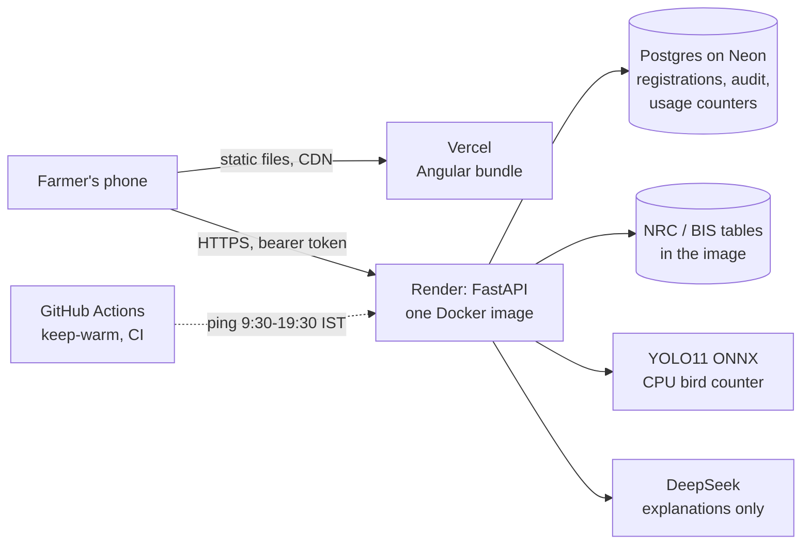

# Poultry 360 — system design

How the system is built, why each choice was made, how it fails, and what changes
as it grows. [ARCHITECTURE.md](ARCHITECTURE.md) covers the agent harness in depth;
this page is the whole system.

## 1. The business problem

A small broiler farm in India (500 to 5,000 birds) runs on guesswork: birds are
counted by hand, feed is guessed, and a sick flock is noticed when birds die.
Feed is about 60-70% of the cost of raising a broiler, so a wrong ration by age is
lost money and stunted birds.

| Who | What they need |
|---|---|
| Farmer | How many birds, how much feed today, is this a vet case, in their language, on a cheap phone |
| Owner (me) | Approve farms, see if the service is healthy, keep the AI bill bounded |

**Functional:** count birds from a photo or video; ration and feed plan by age
(from NRC 1994 / BIS IS 1374 tables); health signs to "what to check, when to call
a vet"; flock diary; 13 languages with read-aloud; farm sign-up and approval.

**Non-functional:**

| Requirement | Target | How |
|---|---|---|
| First screen | under 5 s on a cold start | static UI on Vercel's CDN; API wakes in the background |
| Feed numbers | never invented | numbers only from tables; a guard flags any figure not in the table |
| Cost | free tier, bounded AI bill | daily caps per farm user (40), per network (60), whole app (400), in the database |
| Data | survives restarts | Postgres (Neon) via `DATABASE_URL` |
| Works without AI | always | every path has a table or rule answer; the model only explains |

## 2. Back of the envelope

At 200 farms, each opening the app ~5 times a day: ~1,000 requests a day, about
one request every 90 seconds on average, a peak of maybe 1 per second at feeding
time. One small instance handles that easily; the expensive parts are the bird
counter (CPU, a few hundred ms to seconds per photo) and AI calls (seconds, and
money). That is why the caps count those, not page views.

Storage is tiny: a registration is ~300 bytes, an audit row ~200 bytes, a usage
counter ~50 bytes per key per day. 200 farms for a year is well under 50 MB,
inside Neon's free 0.5 GB.

## 3. Architecture

- **Static UI on Vercel, API on Render.** Render's free server sleeps after 15
  idle minutes and takes ~30 s to wake. The UI no longer waits for it: it loads
  from the CDN in about a second and starts waking the API at once.
- **One image** serves the API and (as a fallback) the UI, so local runs and the
  old URL keep working.
- **Stateless API.** Sign-in is a signed token; anything that must last is in
  Postgres. Any instance can serve any request, so it can scale out.

## 4. Data model

| Table | Columns | Why it is in the database |
|---|---|---|
| `registrations` | id, farm, owner, phone, email, district, status (pending / approved / rejected / revoked), tenant, username, created_at | A pending request or a revocation lost on restart is a real bug: a blocked farm could sign in again |
| `audit_log` | at, actor, action, target, detail, request_id | Who gave or removed access, and when; the request id links it to the log line |
| `usage_counters` | (day, key) → count | The daily caps bound the AI bill; held in memory, every restart reset them |

The tenant key is `slug.HMAC(slug, username)`, so a key is checked without a
database read, and an approved farm can still sign in if the database is down.
The flock diary stays on the phone for now (see section 9).

## 5. Key decisions

| Decision | Alternatives | Why this one | When I would change it |
|---|---|---|---|
| Numbers from published tables; the model only explains | Let the model answer | A wrong feed number harms birds. The model may explain a number, never originate one | Never for numbers |
| Router: factual / explanatory / diagnostic | Always call the model | Most questions are lookups; no model means free, instant, exact | — |
| HMAC tenant keys, stateless tokens | Sessions in a database or Redis | No lookup per request, survives a database outage, no extra service | When I need instant logout of one device: add a token denylist |
| Postgres via SQLAlchemy Core; SQLite locally | Keep SQLite, or an ORM | Same SQL on both, so tests on SQLite run the production queries; CI also runs the suite on Postgres | — |
| Caps in the database, one atomic upsert per key | Redis counters | One fewer service; a few writes per protected call is nothing at this scale | At thousands of requests a second: Redis `INCR` with a TTL |
| YOLO11 exported to ONNX, CPU | A GPU service, a cloud vision API | Free hosting has no GPU; ONNX on CPU is fast enough for one photo | Many videos at once: a separate worker with a queue |
| CORS `*` | A fixed origin list | Sign-in is a bearer header, never a cookie, so another site cannot ride a farmer's session. `POULTRY_CORS` can narrow it | If sign-in ever moves to cookies |
| Keep-warm 9:30-19:30 IST | Always on | Render gives 750 free hours a month; two services always on need ~1,490 | When there is revenue: a $7 always-on instance |

## 6. How it fails

| What fails | What the farmer sees | How I find out |
|---|---|---|
| Render server asleep | The UI opens at once; the first action waits ~30 s | Portfolio health badge; `/api/health` latency |
| AI key missing, slow or erroring | The table answer, without the explanation | Ops panel: AI fallback rate, AI p95 latency |
| Model invents a figure | The answer is flagged and the table figure is shown | Grounding guard; evals in CI |
| Database unreachable | Sign-up fails with a clear error; approved farms still sign in (HMAC key) | `/api/ready` returns 503 |
| A bug throws | `{"detail": ..., "request_id": ...}`, never a stack trace | One JSON log line with the same request id |
| A feature's data fails its self-check | That feature is not served; the rest is | `/api/health` lists it as unhealthy |
| Someone hammers sign-in | 429 after 10 tries in 15 minutes per network | Ops panel 4xx counts |

## 7. Security and privacy

- **Tenant isolation:** every protected call carries a signed token naming the
  farm; sign-in is required for every action that spends CPU or the AI key.
- **Secrets:** `POULTRY_SECRET`, `ADMIN_KEY`, `DEEPSEEK_API_KEY` and
  `DATABASE_URL` live only in Render's environment, never in git.
- **Admin:** a separate key, compared in constant time; every approval,
  rejection and revocation is in the audit log.
- **Headers:** `nosniff`, `X-Frame-Options: DENY`, HSTS and a referrer policy
  on every response.
- **Uploads:** photos 12 MB, videos 80 MB; photos are processed in memory, not
  stored.
- **Personal data:** only what is needed to send a key (name, phone or email,
  district).

## 8. Observability

- **Request id** on every response (`X-Request-ID`); kept if the caller sends one.
- **One JSON log line per request:** request id, method, route template,
  status, latency, farm. On Render, search the logs by request id.
- **Ops panel** (`/admin`, `GET /api/admin/ops`): calls, error rate, AI calls,
  fallbacks, p95 latency per route, farms active today, and whether storage is
  durable.
- **Audit log** (`GET /api/admin/audit`).
- **Health vs readiness:** `/api/health` says the process is up and which
  features are healthy; `/api/ready` also checks the database.

## 9. Growing it

| Scale | What changes |
|---|---|
| Now (tens of farms) | One free instance, Neon free, keep-warm in the daytime |
| 10x (hundreds of farms) | Paid always-on instance; flock diary moves to the server (table `flocks`, `flock_days`) so FCR can be computed and backed up; Alembic migrations |
| 100x (thousands) | 2+ API instances behind the load balancer (already stateless); bird counting moves to a worker pool behind a queue; caps move to Redis; read replicas are not needed yet, as the data is small |

## 10. Honest limits

- Ops metrics are in memory, so they reset on restart (the audit log and caps do not).
- Bird-count accuracy is not yet measured on labelled shed photos; that is the next eval.
- The schema is created with `create_all`; with the first column change I would add Alembic.
- Without `DATABASE_URL` set, the free disk is used and is wiped on restart; the ops panel says so.

## 11. Questions an interviewer may ask

**Why not let the LLM answer feed questions directly?** A number a farmer acts on
must be right every time, and models invent plausible figures. Tables give the
number; the model is allowed to explain it, and a guard checks every figure in
its reply against the table.

**How do you know the router works on Hinglish?** 40 questions in English, Hindi
and Hinglish run in CI with a floor. The first run found Hinglish trouble reports
routed as plain lookups (5 of 13 right); fixed to 100%, in-sample, which I say
openly.

**Why HMAC tenant keys instead of storing keys?** Checking a key is a hash, not a
database read, and it keeps working if the database is down. The cost is that
revoking needs a database row, which is why revocations are now durable.

**What happens if two requests hit the cap at the same moment?** Each key is an
atomic `INSERT ... ON CONFLICT DO UPDATE count = count + 1`. Two requests can both
read 39 and both pass, so the cap can be exceeded by the number of concurrent
requests, one or two. For a cost guard that is acceptable; for money I would use
`UPDATE ... WHERE count < cap RETURNING`.

**How would you debug "it failed for my farm"?** Ask for the request id the error
shows, search the JSON logs for it: route, status, latency, farm. If it was an
admin change, the audit row carries the same id.

**Why Postgres and not keep SQLite?** Render's free disk is wiped on every
restart, and the free server restarts every time it sleeps. Pending sign-ups,
revocations and the daily caps were being lost. Neon's free Postgres keeps them.

**How does it scale out?** The API holds no session state, so more instances work
behind the load balancer. The two things that would need to change are the
in-memory ops metrics (move to Prometheus or the database) and the bird counter
(move to a worker queue so a long video does not block API workers).

**Why is the UI on a different host from the API?** So the page never waits for
a sleeping server. Sign-in uses a bearer header, so cross-origin calls need no
cookies and no CSRF protection.
